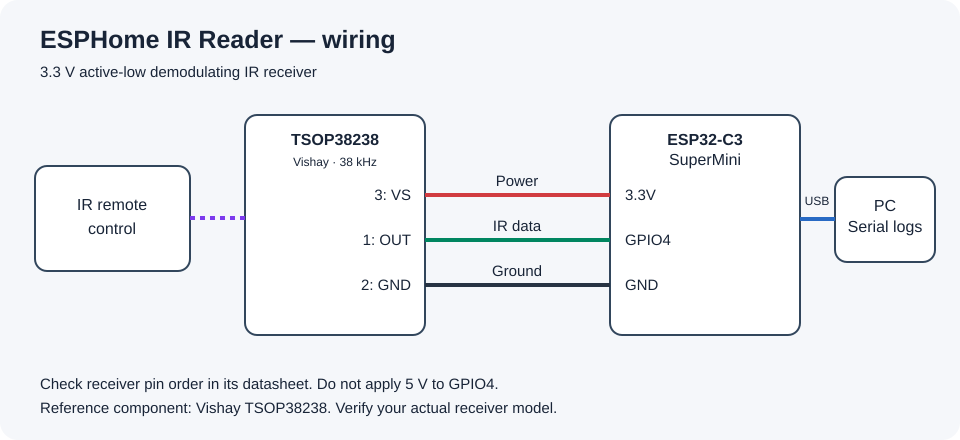

# ESPHome IR Reader

A standalone infrared remote-control decoder for the ESP32-C3 SuperMini using ESPHome and Arduino. No Wi-Fi, MQTT or Home Assistant is required.

## Hardware

- ESP32-C3 SuperMini
- Vishay TSOP38238 — 38 kHz demodulating IR receiver (reference component)
- Three jumper wires and a USB data cable

## Wiring



| IR receiver | ESP32-C3 |
|---|---|
| Pin 3 — VS | 3.3V |
| Pin 2 — GND | GND |
| Pin 1 — OUT | GPIO4 |

**Important:** The TSOP38238 is a verified compatible reference component, not a confirmed identification of the original receiver. Check its datasheet for pin order and supply voltage. The ESP32-C3 input is not 5 V tolerant. Use an active-low, 3.3 V-compatible output.

[Vishay TSOP38238 datasheet](https://www.vishay.com/docs/82491/tsop382.pdf) — supply range: 2.5–5.5 V; use 3.3 V with ESP32-C3.

## Installation

Install [ESPHome](https://esphome.io/guides/installing_esphome/), connect the board with a USB data cable and run:

```sh
esphome run ir_citacka.yaml
```

Select the serial port when prompted. If flashing fails, follow the board's bootloader procedure. To reopen logs:

```sh
esphome logs ir_citacka.yaml --device PORT
```

Replace `PORT` with the actual serial port (e.g. `COM3` or `/dev/ttyACM0`). Serial logging depends on the board's USB interface and ESPHome logger configuration; if no logs appear on a native USB board, try setting `hardware_uart: USB_SERIAL_JTAG` under `logger`.

## Usage

Point a remote control at the receiver and press a button. Inspect the logs for decoded addresses and commands. Supported decoders: NEC, LG, Samsung and JVC. Other protocols are not included in this configuration.

| Setting | Value |
|---|---|
| Input | GPIO4, inverted |
| Tolerance | 30% |
| Filter | 100 µs |
| Idle | 20 ms |
| Log level | INFO |
| Baud rate | 115200 |

The original YAML is preserved as supplied. If your ESPHome version rejects underscores in device names, change `ir_citacka` to `ir-citacka`. This repository package has not been compiled or hardware-tested during packaging.
