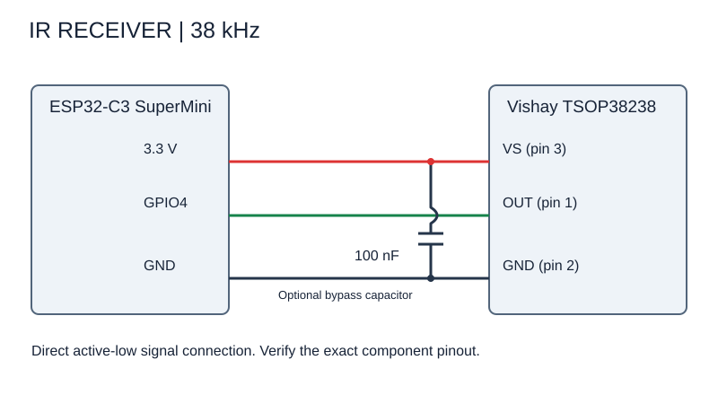
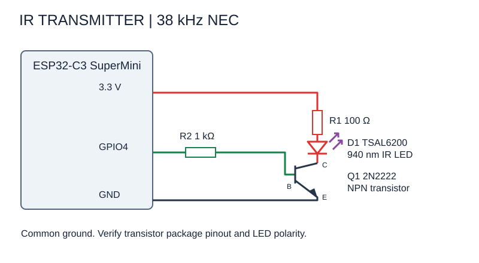

# ESPHome IR Reader & Transmitter

Two independent ESPHome examples for reading and transmitting infrared remote control commands using an ESP32-C3 SuperMini. The receiver logs NEC, LG, Samsung and JVC codes over USB; the transmitter sends example NEC commands from Home Assistant over Wi-Fi.

## Files

- `receiver.yaml` — standalone IR receiver.
- `transmitter.yaml` — Wi-Fi IR transmitter with example buttons.
- `docs/receiver_wiring.svg` — receiver wiring.
- `docs/transmitter_wiring.svg` — transmitter wiring.

## IR receiver

Example hardware: ESP32-C3 SuperMini and Vishay TSOP38238 (38 kHz, active-low IR receiver).



Connect OUT (pin 1) to GPIO4, GND (pin 2) to GND, and VS (pin 3) to 3.3 V. A 100 nF bypass capacitor close to the receiver is optional for noise suppression. No external signal resistor is required for this example. Verify the pinout for any substitute receiver.

```sh
esphome run receiver.yaml
```

Use the serial logs at 115200 baud, point a remote at the receiver, and press a button. Record the decoded address and command. No Wi-Fi or Home Assistant is required for this configuration.

## IR transmitter

Example hardware: ESP32-C3 SuperMini, Vishay TSAL6200 (940 nm IR LED), 2N2222 NPN transistor, 100 ohm LED resistor and 1 kohm base resistor.



Connect 3.3 V through the 100 ohm resistor to the LED anode. Connect its cathode to the transistor collector. Connect GPIO4 through the 1 kohm resistor to the base, and connect the emitter to GND. Check the transistor pinout for the exact package. The conservative LED current limits range; do not omit the current-limiting resistor.

Create a local `secrets.yaml` beside `transmitter.yaml`:

```yaml
wifi_ssid: "YOUR_WIFI_SSID"
wifi_password: "YOUR_WIFI_PASSWORD"
```

Do not publish your secrets. Replace the illustrative NEC addresses and commands with captured codes for your own device. Flash the transmitter:

```sh
esphome run transmitter.yaml
```

Add the ESPHome device to Home Assistant and use the exposed buttons. The NEC action uses a 38 kHz carrier; the configured carrier duty cycle is 50%. For other protocols, use the appropriate ESPHome transmit action. Configure API encryption and OTA authentication before using on an untrusted network.

## Notes

The configurations are separate examples, both using GPIO4; do not connect both circuits to that same pin simultaneously. Use separate boards or flash the appropriate firmware when switching circuits. Component models are examples, not requirements. The receiver retains the supplied decoder settings, with an English device name. The transmitter codes are illustrative and are not guaranteed to control any specific device. Firmware compilation and hardware tests have not been performed on this package.

## References

- [ESPHome Remote Receiver](https://esphome.io/components/remote_receiver/)
- [ESPHome Remote Transmitter](https://esphome.io/components/remote_transmitter/)
